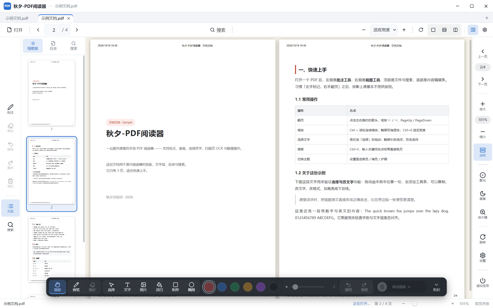
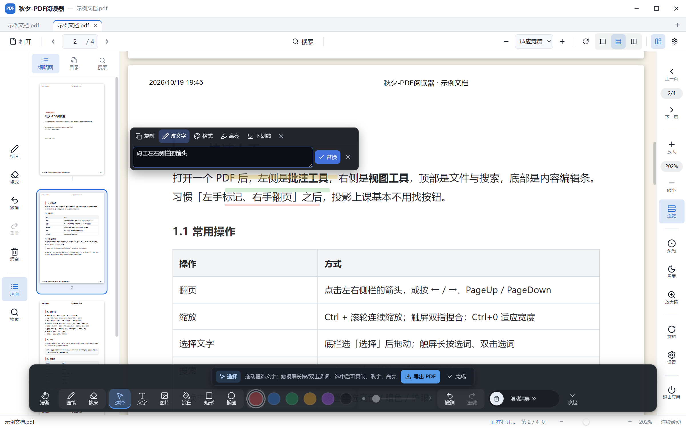
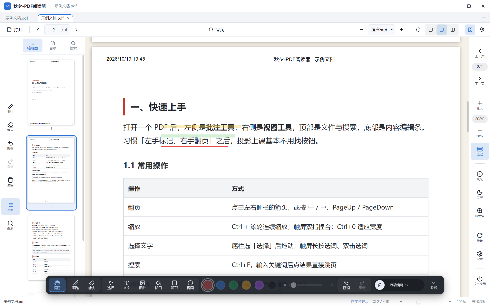
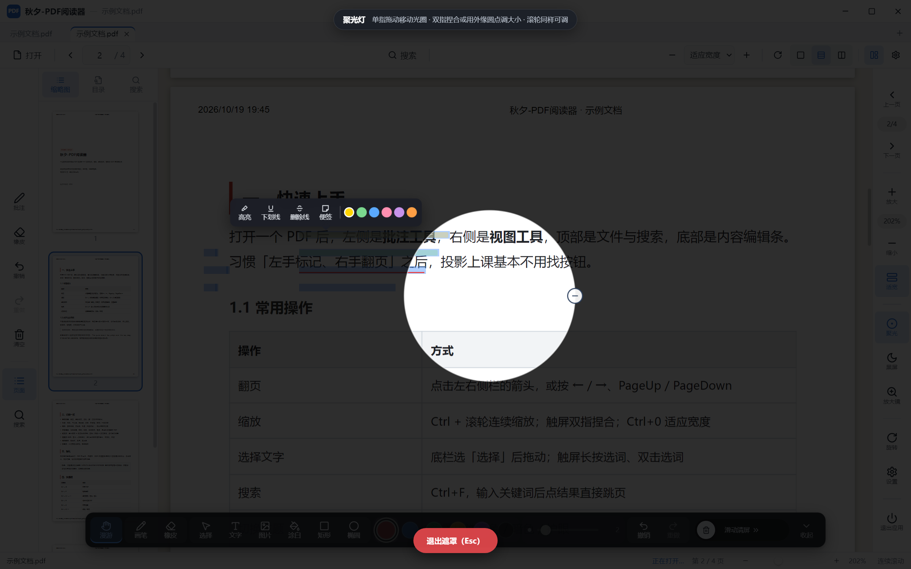
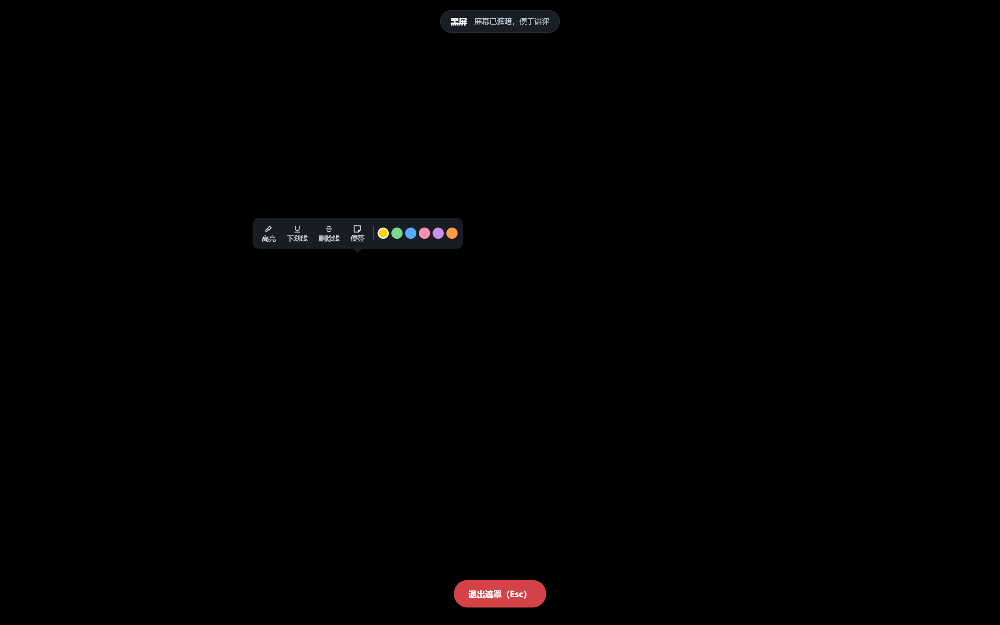
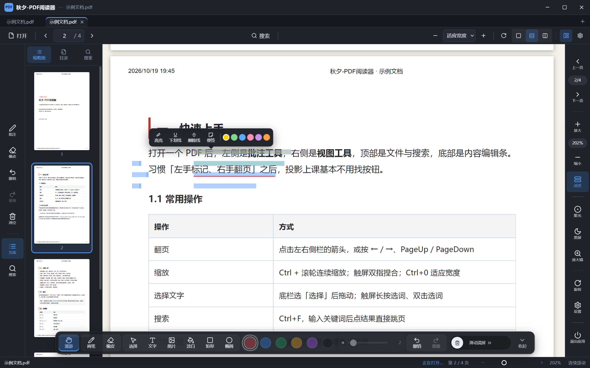
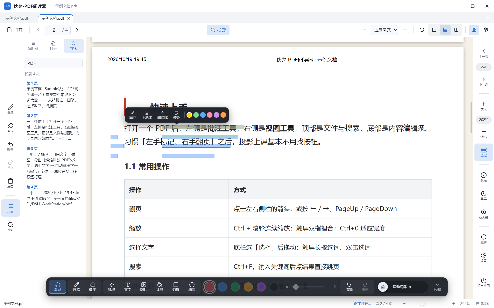

# 秋夕-PDF阅读器

> 面向课堂与自习的**本地 PDF 阅读器**：批注、画笔、选中改字、扫描页 OCR、触摸操作，全部离线完成。

<p align="center">
  
</p>

<p align="center">
  
  
  
  
  
</p>

<p align="center">
  <a href="https://github.com/QiuXiYueShiJiu/QX-PDFreader/releases"><b>下载安装包</b></a>
  ·
  <a href="https://github.com/QiuXiYueShiJiu/QX-PDFreader/issues">问题反馈</a>
  ·
  <a href="LICENSE">许可证</a>
</p>

---

## 这是什么

一个装在教室一体机或办公电脑上的 PDF 阅读器。它不追求「什么格式都能开」，而是把**上课真正会做的几件事**做顺：

- 一边投影一边在原文上画重点、写批注；
- 学生做错的那句话，**直接改成正确表述**（不是贴便签盖住）；
- 试卷是扫描件、没有文字层时，**识别一遍就能选中、复制、修改**；
- 老师用手直接点、长按、拖，不必先找鼠标。

全部功能本地运行，**不上传文件、不联网**，OCR 的语言包与识别引擎随安装包一起提供。

---

## 功能特性

### 阅读

| 能力 | 说明 |
|---|---|
| 三种视图 | 单页 / 连续滚动 / **双栏**（第 1 页起两两配对，像翻开的书） |
| 缩放 | 适应宽度、连续缩放、Ctrl + 滚轮、触屏双指捏合；最高 600% |
| 页面导航 | 左侧缩略图、文档目录（PDF 书签）、页码直达、上一页 / 下一页 |
| 全文搜索 | Ctrl + F，结果按页列出，点一条直接跳过去 |
| 多标签 | 一次打开多份文档，标签可拖动排序 |
| 主题 | 亮色 / 暗色 / 护眼（米黄），阅读区底色可单独调 |
| 记忆 | 记住上次阅读位置、最近文件、界面缩放 |

### 批注与画笔

- **文字批注**：高亮、下划线、删除线、便签，四种颜色可选；
- **自由画笔**：压感笔迹、荧光笔、直线、矩形 / 椭圆、箭头、文字标注、插图；
- **橡皮**：像真实橡皮一样**局部擦除**，大小可调，不整笔删除；
- **撤销 / 重做 / 一键清空**：清空也可撤销，误触能救回来；
- **漫游模式**：画面放大后拖动浏览，不误建批注。

### 内容编辑（这一版的重点）

选中原文 → 浮出工具条 → **改文字 / 改格式**：

- **自动继承原文字号、颜色、字体、粗细、斜体**，改完和原文几乎看不出接缝；
- **多行替换**：一次替换整段，按行逐行遮盖，保留换行；
- **导出即烘焙**：批注与编辑结果在「导出为新 PDF」时写进新文件，源文件不动。

### 扫描页 OCR

- 一键识别当前页（简体中文 + 英文）；
- 识别结果是**真正的文字层**：可选中、可复制、可**直接改文字**；
- 首次识别约 3–5 秒，之后同一页可重复识别；
- 语言包与 wasm 引擎随安装包分发，运行时不下载任何东西。

### 课堂辅助

- **聚光灯**：只照亮指针附近，引导注意力；
- **黑屏**：讲评时压暗屏幕，让学生抬头；
- **放大镜**：局部放大正文，小字号教材也能看清。

### 触摸

- 长按 360ms 选词、双击选词、拖动扩选；
- 一按就拖＝平移页面（带惯性），轻点灰底取消选区；
- 双指捏合缩放，缩放锚点跟着手指走；
- 左右两侧工具条按拇指可达范围排布。

---

## 截图

| 主界面（连续滚动 + 缩略图） | 双栏视图 |
|---|---|
|  |  |

| 选中改字（自动继承字号颜色） | 高亮与批注 |
|---|---|
|  |  |

| 聚光灯 | 黑屏 |
|---|---|
|  |  |

| 暗色主题 | 全文搜索 |
|---|---|
|  |  |

---

## 下载与安装

到 **[Releases](https://github.com/QiuXiYueShiJiu/QX-PDFreader/releases)** 页面下载：

- 文件名：`QX-PDFreader-1.0.0.1-setup.exe`（安装后程序名仍为「秋夕-PDF阅读器」）
- 双击安装，可自选安装目录；
- 「选择附加任务」页可分别勾选**桌面快捷方式**与**开始菜单快捷方式**（默认都勾，开始菜单统一放在「秋夕-教学软件」文件夹）；
- 静默安装（批量部署）：`QX-PDFreader-1.0.0.1-setup.exe /S`

系统要求：Windows 10 / 11（x64）。安装包未做代码签名，首次运行若出现 SmartScreen 提示，选择「更多信息 → 仍要运行」。

> **卸载提醒**：卸载会一并删除 `%APPDATA%\秋夕月拾旧-PDF阅读器` 下的用户数据（阅读位置、最近文件、批注）。需要保留请先备份该目录。

---

## 快速上手

1. 打开 PDF：`Ctrl + O`，或把文件拖进窗口；
2. 左侧选「选择」→ 在文字上拖动（触屏长按）→ 浮出工具条；
3. 点「改文字」→ 输入新内容 → 回车或点「替换」；
4. 想标重点就直接选「高亮」；想手写就切「画笔」；
5. 扫描件点顶部菜单「识别扫描页文字」，识别完就能选中文字；
6. 讲评时用右侧「聚光 / 黑屏 / 放大镜」，退出按 Esc 或再点一次。

### 快捷键

| 快捷键 | 作用 |
|---|---|
| `Ctrl + O` | 打开 PDF |
| `Ctrl + F` | 搜索全文 |
| `Ctrl + 0` / `Ctrl + +` / `Ctrl + -` | 适应宽度 / 放大 / 缩小 |
| `Ctrl + R` | 顺时针旋转 90° |
| `Ctrl + S` | 打开设置 |
| `Ctrl + Z` / `Ctrl + Y` | 撤销 / 重做 |
| `←` / `→`、`PageUp` / `PageDown` | 上一页 / 下一页 |
| `Esc` | 退出当前工具或遮罩 |

---

## 隐私

- **完全本地**：PDF 不上传，运行时不发起任何网络请求（OCR 资源随包提供）；
- **不收集**：没有账号、没有埋点、没有崩溃上报；
- **数据位置**：最近文件、阅读位置、批注、设置都在 `%APPDATA%\秋夕月拾旧-PDF阅读器`，删掉即恢复初始状态。

---

## 技术栈

| 层 | 选型 |
|---|---|
| 桌面壳 | Electron 33（单窗口 + 多标签） |
| 界面 | React 18 + TypeScript + zustand |
| 构建 | electron-vite 2 + electron-builder 25 |
| 渲染 | pdf.js 4（`TextLayer` 文字层 + canvas 画布） |
| 导出 | pdf-lib（把批注与编辑烘焙进新 PDF） |
| OCR | tesseract.js 5（简中 + 英文语言包，本地 wasm） |

### 目录结构

```
├─ src
│  ├─ main          Electron 主进程（窗口、IPC、文件、单实例）
│  ├─ preload       上下文隔离的桥（window.pdfApp）
│  ├─ shared        主/渲染共享类型
│  └─ renderer      界面：DocumentView、AnnotationLayer、edit/*、ocr/*、store
├─ tools            验证脚本（CDP 驱动的隐藏窗口回归套件）
├─ scripts          构建 / 打包 / 版本 / 资源复制
├─ build            图标、安装器模板（NSIS）、打包参数
├─ tests/fixture    测试用 PDF
└─ docs             截图与示例文档
```

---

## 从源码构建

需要 Node.js 22+ 与 Windows 10/11。

```powershell
git clone https://github.com/QiuXiYueShiJiu/QX-PDFreader.git
cd QX-PDFreader
npm install
npm run dev                         # 开发运行
npm run build                       # 产出 out/
node scripts\build-installers.mjs   # 打包两个安装程序
```

安装目录、品牌文案、快捷方式命名等交付参数在 `build/packaging.json`，构建脚本会把它渲染进 NSIS 安装器脚本（`build/installer.nsh.in`）。

## 回归测试

套件用 CDP 驱动**隐藏窗口**跑真实交互（鼠标 / 触摸 / 滚轮事件都是原生注入，不是合成 DOM 事件），共 25 支：

```powershell
node tools\check-licenses.mjs                # 许可证闸门
node tools\run-verify-suite.mjs --dev 9401   # 全量（约 6 分钟）
node tools\run-verify-suite.mjs --dev 9401 verify-select.mjs   # 单支
```

---

## 许可证

本项目使用 **PolyForm Noncommercial License 1.0.0**（PNC 1.0）：

- ✅ 个人使用、学习、研究、非营利教学——随便用，可以改；
- ✅ 可以 fork、二次开发、校内批量部署；
- ❌ **不得用于商业用途**（随硬件销售、付费培训、商业产品内置、SaaS 等）；
- 商业授权请通过 Issues 联系作者。

完整条款见 [LICENSE](LICENSE)；版权与第三方组件声明见 [NOTICE](NOTICE) 与 [THIRD-PARTY-NOTICES.md](THIRD-PARTY-NOTICES.md)。

> PolyForm Noncommercial 不是 OSI 认可的开源协议：源码公开可读、可改，但商业使用需要另行授权。

## 第三方组件

Electron、React、pdf.js、pdf-lib、tesseract.js 等组件的版权与许可证声明见 `THIRD-PARTY-NOTICES.md`。

## 免责声明

本软件按「现状」提供，不附带任何明示或暗示的担保。因使用本软件造成的任何数据丢失或损失，作者不承担责任。请自行备份重要文档与批注。

---

<p align="center"><sub>秋夕月拾旧 · 2026</sub></p>
