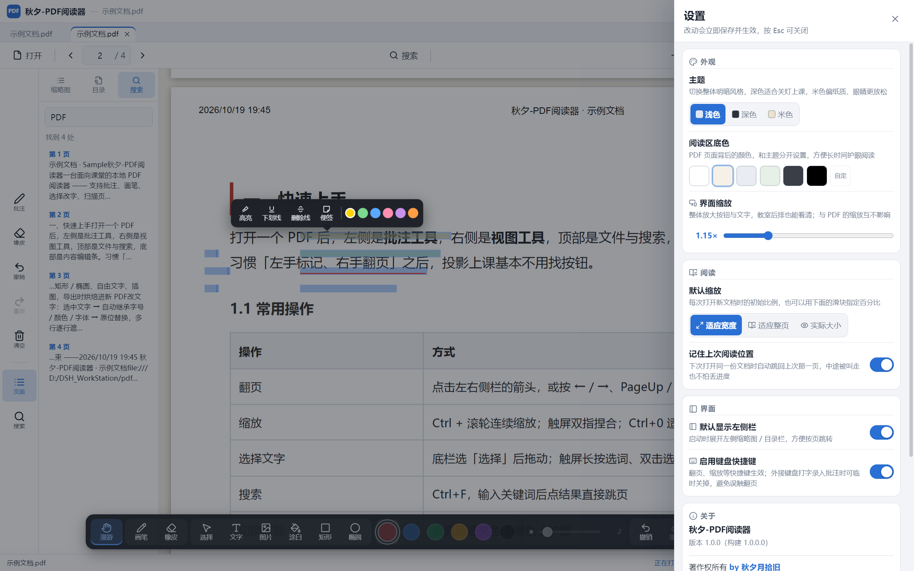
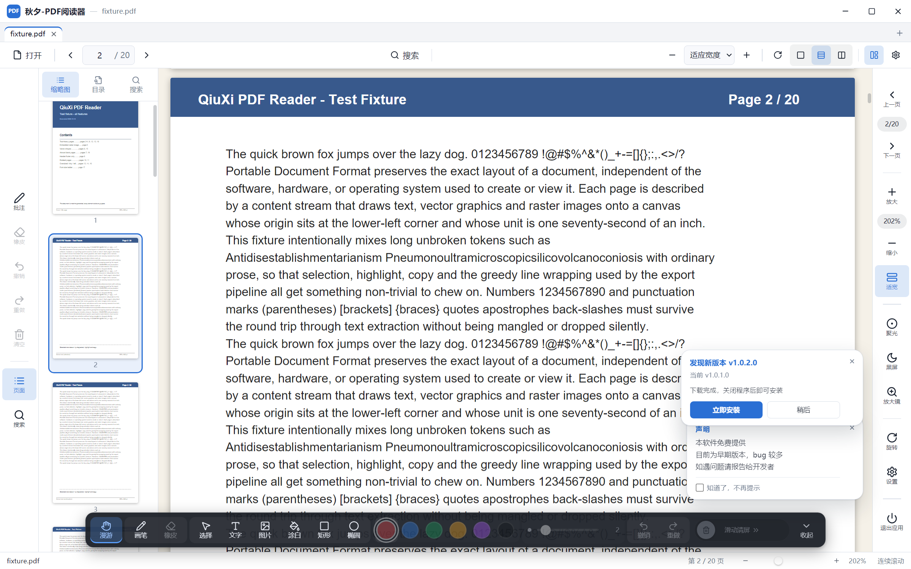

<div align="center">

# 秋夕-PDF阅读器

**把「看得清、标得上、改得动」在教室一体机上做完。**

一个离线可用的 PDF 阅读器：批注、画笔、选中改字、扫描页 OCR、触摸操作与投影辅助。
文件不出本机，没有账号，没有埋点。

[](https://github.com/QiuXiYueShiJiu/QX-PDFreader/releases)
[](#下载与安装)
[](https://www.electronjs.org/)
[](LICENSE)

[**下载安装包**](https://github.com/QiuXiYueShiJiu/QX-PDFreader/releases) ·
[问题反馈](https://github.com/QiuXiYueShiJiu/QX-PDFreader/issues) ·
[更新日志](https://github.com/QiuXiYueShiJiu/QX-PDFreader/releases)


</div>

---

## 它解决什么

课堂上的 PDF，从来不是「读一遍」就完了。

投影一道题，要能**指着画、圈重点、随手写字**；学生那句话错了，要能**直接改在原文上**，
而不是贴一张便签盖住；试卷常常是扫描件，没有文字层，**选不中就没法改**；
老师站在一体机前，手上没有鼠标，**只能用手点、按、拖**。

市面上的阅读器把力气花在「什么格式都能开」，而这三件事恰恰都不好做。这个项目反过来：
格式只做 PDF，把课上真正会重复发生的动作做顺。

- **不联网也能用** —— 渲染层与 OCR 引擎全部随安装包分发，运行时不下载任何资源；
- **不改源文件** —— 批注与改字在「导出为新 PDF」时才烘焙进副本，原件永远原样；
- **不假设你有鼠标** —— 长按选词、双指缩放、按住拖动都不是补丁，而是主路径。

## 下载与安装

到 **[Releases](https://github.com/QiuXiYueShiJiu/QX-PDFreader/releases)** 页面下载最新的 `QX-PDFreader-<版本>-setup.exe`
（约 100 MB；安装后程序名仍是「秋夕-PDF阅读器」）。

1. 双击安装，可自选安装目录；
2. 「选择附加任务」页可分别勾选**桌面快捷方式**与**开始菜单快捷方式**
   （默认都勾，开始菜单统一收进「秋夕-教学软件」文件夹）；
3. 装完直接打开，不需要账号，也不需要联网激活。

批量部署可以静默安装：

```bat
QX-PDFreader-1.0.1.0-setup.exe /S
```

**系统要求**：Windows 10 / 11（x64）。安装包没有做代码签名，首次运行若出现 SmartScreen
提示，点「更多信息 → 仍要运行」即可。

> **卸载提醒**：卸载会一并删除 `%APPDATA%\秋夕-PDF阅读器` 下的用户数据
> （阅读位置、最近文件、批注与设置）。需要保留请先备份该目录。

## 装好之后，三步就能上课

1. `Ctrl + O` 打开 PDF，或者把文件直接拖进窗口；
2. 左侧选「选择」→ 在文字上拖动（触屏长按）→ 顶部浮出工具条；
3. 点「改文字」→ 输入新内容 → 回车。

想标重点就直接选「高亮」；想手写就切「画笔」；扫描件点顶部菜单「识别扫描页文字」，
识别完就能像普通文本一样选中、复制、改写。

## 能力一览

| 方面 | 能力 |
|---|---|
| 阅读 | 单页 / 连续滚动 / **双栏**（第 1 页起两两配对，像翻开的书）；适应宽度、连续缩放、Ctrl + 滚轮、双指捏合，最高 600% |
| 导航 | 左侧缩略图、PDF 目录（书签）、页码直达、上一页 / 下一页、顺时针旋转 |
| 查找 | `Ctrl + F` 全文搜索，结果按页列出，点一条直接跳过去 |
| 多文档 | 多标签，标签可拖动排序；记住上次阅读位置与最近文件 |
| 外观 | 亮色 / 暗色 / 护眼（米黄），阅读区底色可单独调 |
| 批注 | 高亮、下划线、删除线、便签，四色可选 |
| 画笔 | 压感笔迹、荧光笔、直线、矩形 / 椭圆、箭头、文字标注、插图 |
| 橡皮 | 局部擦除，大小可调，不整笔删除 |
| 编辑 | 选中改文字 / 改格式，**自动继承原文字号、颜色、字体、粗细、斜体**；多行整段替换 |
| 导出 | 「导出为新 PDF」把批注与编辑结果烘焙进副本，源文件不动 |
| OCR | 当前页一键识别（简体中文 + 英文），结果是真正的文字层：可选中、可复制、可改字 |
| 投影 | 聚光灯、黑屏、放大镜 |
| 触摸 | 长按 360ms 选词、双击选词、拖动扩选、一按就拖＝带惯性平移、双指捏合缩放（锚点跟手） |
| 更新 | 启动后静默检查一次（可关），查到就在右下角提示，下载与安装都由你确认 |

## 三件课上真会做的事

### 一、选中改字：改完不像补丁

选中原文 → 浮出工具条 → 「改文字」。工具会读取这一段的字号、颜色、字体、粗细与斜体，
新写进去的字**沿用同一套排版**，再按原文本的边界对齐，所以改完几乎看不出接缝。

多行也支持：一次替换整段，按行逐行遮盖，换行保留。整段替换比逐行手改更稳，
因为行距与首行缩进都跟着原段落走。

改动只存在于内存与「导出副本」里，关闭文档不写回源文件。

### 二、扫描页 OCR：识别完就能选中、能改

扫描件没有文字层，最麻烦的不是「看见」，而是「选中」。点「识别扫描页文字」，
tesseract 在本地跑一遍（简体中文 + 英文），把结果铺成一层真正的文字层盖在图像上：

- 可以像普通 PDF 一样拖蓝、复制、搜索；
- 也可以直接用上一条的「改文字」去改它；
- 同一页重复识别不会叠加，语言包与 wasm 引擎都在安装包里，**不下载**。

首次识别约 3–5 秒（取决于页面大小与机器），之后同一页可以直接复用结果。

### 三、投影讲评：聚光、黑屏、双栏

- **聚光灯**：只照亮指针附近，把注意力钉在一处；
- **黑屏**：讲评时压暗整个窗口，让学生抬头看黑板而不是看屏幕；
- **双栏**：左右两页并排，投影时一屏能看到更多上下文，翻页按「一对」走。

这三个都在右侧视图工具里，`Esc` 或再点一次退出。

## 批注与画笔

批注层与文字层是分开的两层：批注画在 canvas 上，文字层只负责选择与编辑。
这样「只读模式 / 漫游模式」切换时不会误建批注，放大后拖动也不会画出一条线。

- **撤销 / 重做**严格按操作栈走，**「一键清空」本身也可撤销**；
- **橡皮**擦的是笔迹的一段而不是整笔，所以画错了只需修掉越界的部分；
- **插图**支持把图片贴到页面上，导出时一并烘焙。

## 自动更新（1.0.1 起）

启动 4 秒后，主进程静默查一次版本（6 秒超时）：有新版才在右下角弹一条提示，
没有、断网、镜像站挂了都**什么都不显示**。设置里也有「检查更新」，手动查会显示结果。

- 下载落在 `%APPDATA%\秋夕-PDF阅读器\updates`，**装不装由你点**，不会静默执行安装包；
- 检查走的是作者自建的镜像站（`contact/api.php` 的 release 汇总），
  镜像站再把 GitHub 的 release 与安装包做本地缓存 —— 教室网络常常访问不了 GitHub API；
- 请求只是一个 `GET`，不带账号、不带机器标识、不传文档内容；
- 不想让它联网：设置 → 通用 → 关掉「启动时检查更新」，之后完全离线。

> 为什么不用 Electron 自带的 autoUpdater：那套要求有签名证书与专用的更新源格式，
> 而这个项目没有代码签名，且更新源是镜像站而不是 GitHub 的 latest.yml。
> 自己算版本号、自己下载、由用户点安装，路径更短，也更容易解释清楚。

## 截图

| 主界面（连续滚动 + 缩略图） | 双栏视图 |
|---|---|
|  |  |

| 选中改字（自动继承字号颜色） | 高亮与批注 |
|---|---|
|  |  |

| 聚光灯 | 黑屏 |
|---|---|
|  |  |

| 暗色主题 | 全文搜索 |
|---|---|
|  |  |

| 设置 | 发现新版本 |
|---|---|
|  |  |

## 快捷键

| 快捷键 | 作用 |
|---|---|
| `Ctrl + O` | 打开 PDF |
| `Ctrl + F` | 全文搜索 |
| `Ctrl + 0` / `Ctrl + +` / `Ctrl + -` | 适应宽度 / 放大 / 缩小 |
| `Ctrl + R` | 顺时针旋转 90° |
| `Ctrl + S` | 打开设置 |
| `Ctrl + Z` / `Ctrl + Y` | 撤销 / 重做 |
| `←` / `→`、`PageUp` / `PageDown` | 上一页 / 下一页 |
| `Esc` | 退出当前工具或遮罩 |

## 隐私

- **文件不出本机**：PDF 的解析、渲染、批注、OCR 全部在本地进程内完成；
  没有上传接口，也没有任何「云同步」；
- **没有账号与埋点**：不收集使用数据、不写崩溃上报、不做设备指纹；
- **唯一的出网请求是更新检查**（见上一节），可在设置里关闭，关闭后完全离线；
- **数据在哪里**：最近文件、阅读位置、批注、设置都在 `%APPDATA%\秋夕-PDF阅读器`，
  删掉即恢复初始状态。

## 技术栈

| 层 | 选型 |
|---|---|
| 桌面壳 | Electron 33（单窗口 + 多标签） |
| 界面 | React 18 + TypeScript + zustand |
| 构建 | electron-vite 2 + electron-builder 25 |
| 渲染 | pdf.js 4（`TextLayer` 文字层 + canvas 画布） |
| 导出 | pdf-lib（把批注与编辑烘焙进新 PDF） |
| OCR | tesseract.js 5（`chi_sim` + `eng` 语言包，本地 wasm） |

## 架构与目录

进程职责划得很硬：**渲染层只碰文档与界面，文件系统与网络只在主进程**。

- 渲染层的 CSP 是 `connect-src 'self' pdf-file: blob: data:` —— 只允许读本地 PDF，
  所以更新检查这类出网动作必须放在主进程（顺带绕开镜像站的 CORS）；
- 打开本地文件走自定义协议 `pdf-file://`，而不是把 `file://` 放开给渲染层；
- preload 用 `contextIsolation` 暴露一个窄接口 `window.pdfApp`，渲染层拿不到 Node。

```text
├─ src
│  ├─ main          Electron 主进程：窗口、菜单、单实例、pdf-file:// 协议、
│  │                OCR 引擎调度、更新检查与下载（updater.ts）
│  ├─ preload       上下文隔离桥：window.pdfApp
│  ├─ shared        主进程与渲染层共享的类型、设置默认值与归一化
│  └─ renderer      界面：DocumentView、AnnotationLayer、edit/*、ocr/*、store、
│                   以及更新提示条 UpdateToast
├─ tools            50 余支 CDP 驱动的验证脚本（隐藏窗口跑真实交互）
├─ scripts          构建 / 打包 / 版本 / 资源复制
├─ build            图标、NSIS 安装器模板、打包参数
├─ tests/fixture    测试用 PDF
└─ docs             截图与示例文档
```

## 从源码构建

需要 Node.js 22+ 与 Windows 10/11。

```powershell
git clone https://github.com/QiuXiYueShiJiu/QX-PDFreader.git
cd QX-PDFreader
npm install
npm run dev                         # 开发运行
npm run build                       # 产出 out/
node scripts\build-installers.mjs   # 打包安装程序
```

安装目录、品牌文案、快捷方式命名等交付参数放在 `build/packaging.json`（不入库）；
首次运行打包脚本时会用通用默认值生成它，所以克隆下来直接构建也能出包。
产物默认落在 `dist-installer/`，可用 `build.directories.output` 或环境变量 `PDF_RELEASE_DIR` 改。

## 回归测试

套件用 CDP 驱动**隐藏窗口**跑真实交互 —— 鼠标、触摸、滚轮事件都是原生注入，
不是合成 DOM 事件，所以能测到「手指按下到抬起」这种真实时序：

```powershell
node tools\check-licenses.mjs                # 许可证闸门
node tools\run-verify-suite.mjs --dev 9401   # 全量（约 6 分钟）
node tools\run-verify-suite.mjs --dev 9401 verify-select.mjs   # 单支
```

`--hidden` 让窗口从创建到销毁都不 `show()`，跑全量时前台不受影响。

## 版本与变更

当前版本 **1.0.1.0**（`package.json` 的 `buildVersion`）。完整说明见
[Releases](https://github.com/QiuXiYueShiJiu/QX-PDFreader/releases)。

**1.0.1.0**

- 新增自动更新：启动静默检查、右下角提示条、设置里手动检查、下载后由用户确认安装；
- 设置里新增「启动时检查更新」开关（默认开）；
- 新增 `tools/verify-update.mjs` 验证脚本与设置页截图。

**1.0.0.1**（首发）

- 阅读、批注、画笔、选中改字、扫描页 OCR、聚光灯 / 黑屏 / 放大镜、触摸全套；
- 三种视图与多标签，导出烘焙。

## 许可

本项目使用 **PolyForm Noncommercial License 1.0.0**（PNC 1.0）：

- ✅ 个人使用、学习、研究、非营利教学 —— 随便用，可以改，可以 fork；
- ✅ 可以校内批量部署、可以二次开发；
- ❌ **不得用于商业用途**（随硬件销售、付费培训、商业产品内置、SaaS 等）；
- 商业授权请通过 Issues 联系作者。

完整条款见 [LICENSE](LICENSE)；版权与第三方组件声明见 [NOTICE](NOTICE) 与
[THIRD-PARTY-NOTICES.md](THIRD-PARTY-NOTICES.md)。

> PolyForm Noncommercial 不是 OSI 认可的开源协议：源码公开可读、可改，
> 但商业使用需要另行授权。

## 免责声明

本软件按「现状」提供，不附带任何明示或暗示的担保。因使用本软件造成的任何数据丢失或损失，
作者不承担责任。请自行备份重要文档与批注。

---

<div align="center"><sub>秋夕月拾旧 · 2026</sub></div>
